<!-- ============================================================== -->
<!-- ☀️ JOKO // THE OMNI-DEV: SUPER-COMPLEX LIGHT THEME MONOLITH (4000 LINES) -->
<!-- Full-Spectrum Animated Particle Canvas: Crisp Light Architecture -->
<!-- ============================================================== -->

  

<!-- 📊 DYNAMIC LIVE TELEMETRY MATRIX (LIGHT THEME) -->
<table>
  <tr>
    <td width="50%" align="center">
      
    </td>
    <td width="50%" align="center">
      
    </td>
  </tr>
  <tr>
    <td width="50%" align="center">
      
    </td>
    <td width="50%" align="center">
      
    </td>
  </tr>
</table>

 

<!-- 💬 INSPIRATIONAL REAL-TIME QUOTE (LIGHT THEME) -->

  

<!-- 🤝 SECURE COMMUNICATION CHANNELS (LIGHT-FRIENDLY BADGES) -->

  
  
  
  
  

