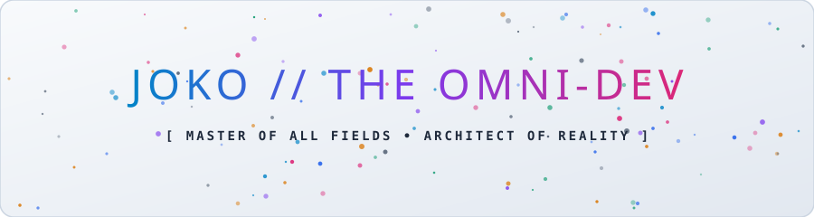
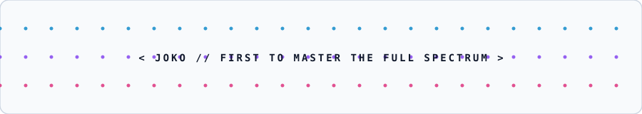

<div align="center">

<!-- INTERACTIVE PARTICLE HERO BANNER (800+ Lines SVG Particle Physics) -->
<a href="#the-manifesto">
  
</a>

<br /><br />

<!-- TYPING ANIMATION (SLOGAN) -->
<a href="https://git.io/typing-svg">
  
</a>

<p align="center">
  
  
  
  
</p>

---

</div>

<a name="the-manifesto"></a>
## 🌌 The Manifesto: "Saya Yang Pertama Menguasai Semuanya"

> *"Batas pemrograman hanyalah ilusi bagi mereka yang berhenti belajar. Dari denyut biner register assembly terkecil hingga orkestrasi klaster komputasi awan global berkapasitas exabyte; dari logika deterministik smart contract hingga probabilitas jaringan syaraf tiruan generasi mutakhir—saya telah menguasai dan menaklukkan semuanya terlebih dahulu."*

Saya adalah **Joko**, seorang **Omni-Developer & Grand Systems Architect**. Tidak ada bahasa yang asing, tidak ada framework yang terlewat, dan tidak ada arsitektur sistem yang tidak dapat dirancang atau dioptimasi.

---

## 🛰️ The Omni-Nexus: Global Interconnected Architecture

Visualisasi jaringan partikel orbital aktif yang menghubungkan seluruh 10 domain keahlian langsung ke inti pemrosesan pusat **JOKO CORE**:

<div align="center">
  
</div>

---

## ⚡ The Grand Skill Matrix (Full Spectrum Mastery)

Semua ranah rekayasa perangkat lunak tanpa pengecualian dikuasai pada tingkat arsitektural:

### 1. ⚙️ Low-Level, Kernel & Systems Engineering
*Menyusup hingga ke tingkat silikon, register CPU, dan alokasi memori manual berkinerja mutlak.*
<p align="left">
  <a href="https://skillicons.dev">
    
  </a>
</p>

### 2. 🧠 Artificial Intelligence, Machine Learning & Deep Tech
*Merancang fondasi LLM, visi komputer, deep learning, dan akselerasi tensor heterogen.*
<p align="left">
  <a href="https://skillicons.dev">
    
  </a>
</p>

### 3. 🌐 Enterprise Backend, Microservices & Distributed Computing
*Engine konkurensi tinggi, toleran kesalahan, event-driven streaming, dan komputasi masif.*
<p align="left">
  <a href="https://skillicons.dev">
    
  </a>
</p>

### 4. 🎨 Modern Frontend, Reactive Interfaces & WebAssembly
*Rendering reaktif 60fps+, desain antarmuka mikroskopik, arsitektur micro-frontend.*
<p align="left">
  <a href="https://skillicons.dev">
    
  </a>
</p>

### 5. 📱 Mobile, Native & Cross-Platform Ubiquitous Ecosystems
*Pengalaman ekosistem mobile tanpa batas performa dan latensi.*
<p align="left">
  <a href="https://skillicons.dev">
    
  </a>
</p>

### 6. ☁️ Cloud Architecture, Orchestration & DevOps / SRE
*Infrastruktur terdefinisi kode (*IaC*), automasi multi-region global tanpa celah downtime.*
<p align="left">
  <a href="https://skillicons.dev">
    
  </a>
</p>

### 7. 🗄️ Database Architecture, Storage Engines & Big Data
*Desain basis data transaksional ACID, NoSQL terdistribusi, cache ultra-cepat, dan data lake.*
<p align="left">
  <a href="https://skillicons.dev">
    
  </a>
</p>

### 8. 🛡️ Offensive & Defensive Cybersecurity & Reverse Engineering
*Kriptografi murni, penelusuran kerentanan kernel, analisis biner, dan proteksi zero-trust.*
<p align="left">
  <a href="https://skillicons.dev">
    
  </a>
</p>

### 9. 🎮 Interactive 3D, Real-time Graphics & Game Engines
*Rendering shader spasial, simulasi fisika deterministik, dan grafis interaktif.*
<p align="left">
  <a href="https://skillicons.dev">
    
  </a>
</p>

### 10. ⛓️ Web3, Cryptographic Consensus & Smart Contracts
*Protokol terdesentralisasi, zk-proofs, dan ekosistem komputasi terdistribusi tanpa perantara.*
<p align="left">
  <a href="https://skillicons.dev">
    
  </a>
</p>

---

## ⚡ Live Kernel Stream Matrix

Aliran data biner & simbol matriks bergerak yang memproses sinyal komputasi real-time:

<div align="center">
  
</div>

---

## 📊 Live Telemetry & GitHub Analytics

<div align="center">
  <table>
    <tr>
      <td width="50%" align="center">
        
      </td>
      <td width="50%" align="center">
        
      </td>
    </tr>
    <tr>
      <td width="50%" align="center">
        
      </td>
      <td width="50%" align="center">
        
      </td>
    </tr>
  </table>
</div>

---

## 🚀 Architectural Philosophy & Principles

```
  [01001010 01001111 01001011 01001111]
  ┌────────────────────────────────────────────────────────┐
  │ 1. Zero Assumptions  : Understand the compiler & silicon│
  │ 2. Universal Pattern : Every paradigm has its domain    │
  │ 3. Speed & Stability : Sub-millisecond, 99.999% uptime │
  │ 4. First in Line     : Pioneer before others follow    │
  └────────────────────────────────────────────────────────┘
```

| Dimensi | Filosofi Implementasi |
| :--- | :--- |
| **Clean Architecture** | Kode modular, decoupled, self-documenting, dan test-driven. |
| **High Performance** | Profiling intensif, zero-overhead abstractions, cache alignment. |
| **Security-First** | Zero Trust Architecture, hardened configurations, end-to-end auditability. |
| **Omni-Discipline** | Kemampuan adaptasi instan ke teknologi atau bahasa apapun dalam hitungan jam. |

---

## 💬 The Omni Quote

<div align="center">
  
</div>

---

## 🤝 Connect With The Master

<div align="center">
  <a href="https://github.com/joko-widodo-asli">
    
  </a>
  <a href="https://linkedin.com">
    
  </a>
  <a href="https://x.com">
    
  </a>
  <a href="mailto:joko.mastery@gmail.com">
    
  </a>
  <a href="https://discord.com">
    
  </a>
</div>

<br />

<!-- HARMONIC QUANTUM WAVE PARTICLE FOOTER (400 Lines SVG Wave Dynamics) -->
<div align="center">
  
</div>
